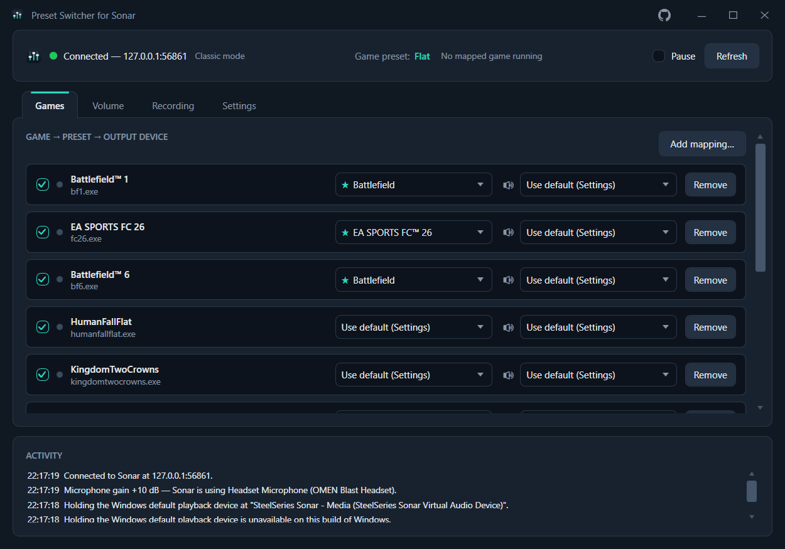
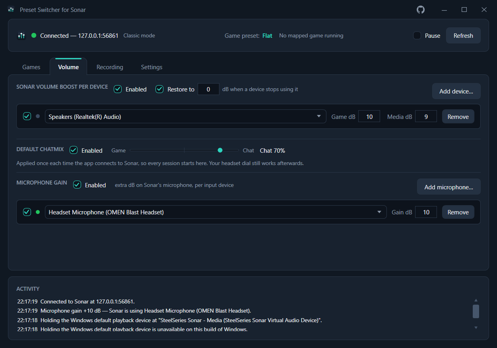
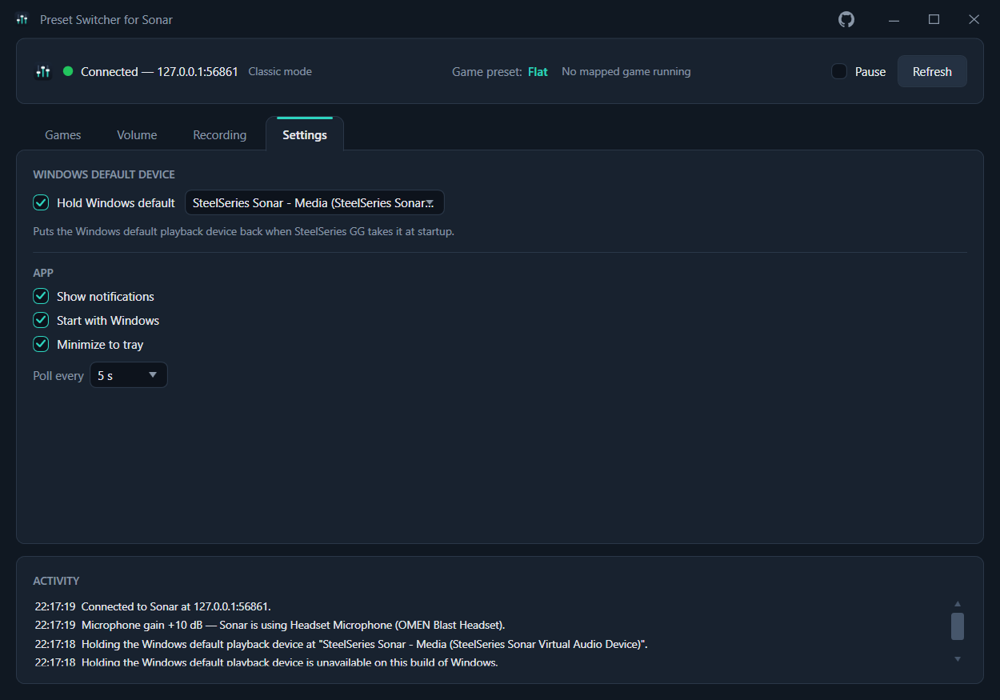

# Preset Switcher for Sonar

[](https://github.com/Shadow-Hussein/PresetSwitcherForSonar/actions/workflows/build.yml)
[](LICENSE)


A small WPF tray app that automatically switches the **SteelSeries Sonar Game-channel preset** when a
game launches, and restores a default preset when no mapped game is running.

An independent project — not affiliated with SteelSeries. Until 1.4.0 it was called *Sonar Preset
Switcher*. Upgrading loses nothing: the first run under the new name takes over the old settings
folder, the "Start with Windows" entry and the Equalizer APO gain file.



*Each row binds a process to a Game preset and, optionally, to a Windows output device. The row for a
game that is running is marked, and the most recently started one wins.*

## Install

Grab the latest `-setup.exe` from
[Releases](https://github.com/Shadow-Hussein/PresetSwitcherForSonar/releases) and run it. It installs for
the current user without an administrator prompt, and the release build is self-contained, so no .NET
runtime install is needed. The installer is not code-signed, so SmartScreen may ask you to confirm.

Uninstalling removes the app, its "Start with Windows" entry and any microphone gain it left in
Equalizer APO. Your settings in `%APPDATA%\PresetSwitcherForSonar` are kept, and a volume boost already
written into a Sonar preset stays in that preset — untick the feature with **restore** on first if you
want those put back. To build from source instead, see below.

## Build & run

```bash
dotnet build "PresetSwitcherForSonar.sln"
```

The executable lands in `src/PresetSwitcherForSonar/bin/Debug/net10.0-windows/PresetSwitcherForSonar.exe`.
Pass `--minimized` to start straight to the tray (this is what the "Start with Windows" toggle registers).

Requires .NET 10 Desktop Runtime and SteelSeries GG running with the Sonar sub-app enabled.

To build the installer, install [Inno Setup 6](https://jrsoftware.org/isinfo.php) and publish with the
profile; the setup exe lands in `artifacts/installer`:

```bash
dotnet publish src/PresetSwitcherForSonar/PresetSwitcherForSonar.csproj -p:PublishProfile=FolderProfile
```

## How it talks to Sonar

Sonar exposes an unauthenticated local REST API, but on a port that changes every time GG launches, so
it has to be discovered at runtime:

1. Read `ggEncryptedAddress` from `C:\ProgramData\SteelSeries\GG\coreProps.json`.
2. `GET https://{ggEncryptedAddress}/subApps` — HTTPS with a self-signed SteelSeries certificate.
3. Take `subApps.sonar.metadata.webServerAddress`, e.g. `http://127.0.0.1:50453`.

Against that base URL:

| Method | Route | Used for |
|---|---|---|
| `GET` | `/configs` | every preset, with `isFavorite` and `favoritePosition` |
| `GET` | `/configs/selected` | the active preset per channel |
| `PUT` | `/configs/{id}/select` | switching the preset |
| `GET` | `/mode` | liveness probe, and classic vs. streamer mixer mode |
| `PUT` | `/mode/{mode}` | switching the mixer mode — value in the path, no body |
| `GET` | `/classicRedirections` | which Windows endpoint each channel plays out of, in classic mode |
| `GET` | `/streamRedirections` | the same for streamer mode: the Monitoring and Streaming mixes |
| `GET` | `/streamRedirections/isStreamMonitoringEnabled` | whether the Monitoring mix is on at all |
| `GET` | `/audioDevices` | every endpoint Sonar knows, with `isVad` |
| `PUT` | `/configs` | saving a whole config — the only way to set `data.generalGain` |
| `GET` | `/v1/chatMix` | the game/chat balance, and whether ChatMix exists on this setup |
| `PUT` | `/v1/chatMix?balance=` | setting the balance |

ChatMix is the one route with a `/v1` prefix — `/chatMix` is a 404 — and its balance binds from the
query string. Sent as a JSON body instead, Sonar answers `200` and writes `0`, so a body would look
like it worked and silently centre the mix.

Any transport failure invalidates the cached URL and the call is retried once against a freshly
discovered endpoint, so restarting GG (which hands Sonar a new port) heals without restarting the app.

## Switching rules

- The most recently started mapped game wins.
- When it exits, the app falls back to the next mapped game still running, then to the default preset.
- A switch is only issued when the target differs from what Sonar reports as selected, so a preset you
  pick by hand in GG mid-game is not overridden.
- Mapped games that were already running when the app starts are picked up on the first poll.
- If a mapped preset is un-starred in GG, the row is flagged and switching is skipped for it.
- A mapping can pick **"Use default (Settings)"** instead of naming a preset. It still wins while it
  runs, so its output device still applies, but the Game preset is left wherever the default puts it —
  which is how a game gets audio routing without a preset switch.

## Recording apps

A separate list on the **Recording** tab, deliberately not part of the game mappings: a
mapping answers "which preset and which speakers", a recording app answers "which microphone, and does
Sonar need to be in streamer mode". Both controls are aimed at OBS, Discord, a voice recorder — apps
that *record*. Neither changes a game's own in-game microphone.

**Records from** is the input half of what Settings → Sound → Volume mixer sets per app, so a row can
point OBS or Discord at a specific microphone — including one of Sonar's virtual ones. The picker lists
Windows' capture endpoints, a different enumeration from the output devices on the Games tab.

A new row **defaults to Sonar's stream channel**: the first capture endpoint whose name contains
"Stream", falling back to Sonar's virtual microphone, and to `Don't change` if Sonar is not installed
at all. Sonar only creates the stream endpoint once streamer mode has been set up with an output, so on
a machine that has never been in streamer mode the fallback is what you get — and rows added later pick
the stream device up on their own. The default is resolved when a row is added and never afterwards, so
it can only ever fill a blank, never overwrite a device you chose.

It overrides the *default* microphone, so two cases fall outside it:

- An app whose own audio settings name a device ignores it. Set those to "Default" first.
- The Windows *communications* default is deliberately left alone, matching what the Volume mixer's own
  input picker writes. That is the endpoint most in-game voice chat asks for, which is the other reason
  this is not the setting for a game's mic.

`Don't change` means exactly that: nothing about the app's input is touched, including anything you set
by hand. `None — system default` is the one that actively clears an override. Like the output override,
Windows stores it per executable and it outlives the process, so it also applies to the next launch —
and an app already recording has to be restarted to move over. Removing a row stops the app being
managed but leaves the override where it is, for the same reason.

**Streamer mode** switches Sonar into streamer mode while that app is running and back to the mode it
was in once it exits. Only a mode this app switched away from is ever put back: if you were already in
streamer mode when the app launched, nothing is recorded and nothing is restored, so it never drags a
full-time streamer into classic. The record is persisted, so being killed mid-stream still leaves the
mixer where you had it — the mode is put back the next time the app starts and finds nothing asking
for it.

The whole section is off by default behind its own **Enabled** box, and with that unticked nothing is
written at all — no device override and no mode switch. The mode switch is edge-triggered rather than
held: changing the mode by hand in GG while the app runs is left alone until the next time a mapped app
starts or stops.

## Detection

`ProcessWatcher` polls the process table (default every 2s) and diffs process names. Polling rather
than WMI events: no WMI permissions needed, no COM lifetime issues, and the first tick naturally
catches games that were already running. Reading `Process.ProcessName` needs no elevation, so
anti-cheat titles running elevated are still detected.

## Holding the Windows default playback device

SteelSeries GG claims the Windows default playback device for its own "Sonar - Gaming" virtual device
every time it starts, so a default you set by hand is gone after the next reboot. GG has no setting to
turn that off.

**Settings → "Hold Windows default"** ticks that back. Pick an output device, and `DefaultDeviceGuard`
puts the system default back to it whenever anything moves it — checking every 2s, and slowing down
rather than fighting if something keeps taking it.

Two things to know:

- This is the only part of the app that writes to Windows itself rather than a per-app override. While
  it is on, changing the default from Windows' Sound settings will not stick; untick it first.
- Only the Console and Multimedia roles are set, the pair behind "Set as Default Device". The
  *communications* default is left alone, so Sonar keeps its Chat device for calls.

Off by default. If you would rather not touch the system default at all, the per-app output device
column does the same job for individual games without it.

## Per-device Volume Boost

Sonar's **Volume Boost** — the 0 to 12 dB slider above the equalizer, applied before processing — is
stored per *preset*, not per device. Send the Game channel from a headset to speakers and the headset's
boost comes with it, so a level that suits one output is wrong on the other.



*A boost per device and per channel — the speakers get 4.5 dB on Game and 3 dB on Media, the headset 6 dB
on Game and nothing on Media. "Restore to 0 dB" puts a preset back when a device stops using it.*

**Sonar Volume Boost per device** saves a Game and a Media boost for each output device. When Sonar
starts playing that channel through it, `ChannelBoostService` applies the saved dB. The two channels are
independent: a device can hold 6 dB for Game and 3 dB for Media, and leaving a box empty leaves that
channel alone entirely. Sonar's own virtual endpoints are kept out of the picker — boosting the channel
that feeds "Sonar - Gaming" would be circular.

**The boost is written into the preset.** Sonar exposes no route that sets a gain directly; the whole
config has to be PUT back, so applying a boost edits whichever preset is selected on that channel at the
time, permanently. Two things follow:

- Applied **on change only** — once set for a device, nothing is written again until something actually
  changes, so you stay free to move the slider by hand afterwards.
- Every preset carries its own boost, so switching presets replaces it. The trigger is therefore the
  *pair* — output device and selected preset — which means a preset switch re-applies the boost while a
  device that has not moved is left alone. Losing and regaining Sonar re-arms it too.

**Both mixer modes work, through different routes.** Classic mode plays each channel straight out to its
own Windows endpoint, and a rule matches that endpoint. Streamer mode has none: every channel is folded
into a **Monitoring** mix (what you hear) and a **Streaming** mix (what goes out), each with an output
device of its own. Rules match the Monitoring device — a boost is a level you picked for the thing you
are listening on — so the Streaming mix is deliberately left alone, which also stops two rules fighting
over the single gain a preset has. With stream monitoring switched off there is nothing to follow, and
the boost is released.

The mode Sonar is in is shown next to the connection status, and a change is logged once as it happens.
A mode the app does not recognise pauses the feature rather than guessing where the audio is going.

Off by default.

### Restoring a boost

On its own the feature never takes a boost back off: unticking it, or moving the channel to a device
with no rule, leaves the last boost sitting in the preset. Tick **"Restore to _n_ dB when a device stops
using it"** to have those presets put back instead. 0 dB is Sonar's own default.

Three things trigger a restore: the feature being switched off, the rule being deleted or disabled, and
the channel moving to a device with no rule.

Only presets this app actually boosted are touched — the ids are recorded in `boostedConfigs`, so a
Volume Boost set by hand in GG is never reset. That record is persisted, so unticking the feature
tomorrow still undoes what was applied today, and a restore that cannot reach Sonar keeps its record and
retries rather than forgetting what it changed.

## Default ChatMix

Sonar's **ChatMix** balances the game and chat audio streams — centred is full volume of both, and
moving towards one end turns the other down. It normally lives on a dial on the headset, and GG has no
setting for where it should start, so a GG restart or a stray bump of the dial leaves it wherever it
landed.

**Default ChatMix** puts your balance back **once, each time the app connects to Sonar** — at startup,
and again after a GG restart. It is deliberately not held: turn the dial afterwards and it stays where
you put it until the next reconnect. Holding it would mean fighting the hardware dial every few seconds,
which is the opposite of what the dial is for.

The slider runs from full Game to full Chat. `ChatMixService` polls `/v1/chatMix` on its own, and the
latch that stops it re-writing is cleared the moment a poll fails — that single fact is what makes the
value come back after GG restarts. Moving the slider re-arms it immediately rather than waiting for the
next reconnect.

Off by default. ChatMix only exists for sources with separate game and chat audio inputs; where Sonar
reports it as unavailable the control greys out and says which state it reported.

## Microphone gain

For a microphone that is still too quiet at 100%. Each row saves an extra gain, 0–30 dB in 0.5 steps,
for one physical microphone, and the gain is applied to **Sonar's microphone while Sonar is using
that one**. Switch microphones in Sonar and the other row's gain takes over — or none, if it has no
row. The dot is green on the row in use.

**This is not a Sonar setting, because Sonar has none.** A mic preset carries the Volume Stabilizer (a
compressor), the noise stages and the EQ — no gain — and Sonar's mic volume is validated to 0–1, so
there is nothing above 100% to ask for. The gain is an
[Equalizer APO](https://sourceforge.net/projects/equalizerapo/) `Preamp` instead.

It is always written for "SteelSeries Sonar - Microphone", never for your own microphone, and that
was measured rather than assumed: **Sonar reads the physical microphone in raw mode, which skips
Equalizer APO entirely.** A 15 dB preamp on the headset mic lifted an ordinary recording stream by
15 dB while Sonar's meter did not move. On Sonar's microphone the gain comes after Sonar's own
processing, so the noise cancelling runs first and every app recording through Sonar hears the
result. Sonar's meter in GG does not show it, for the same reason.

So the rows pick *when*, and Sonar's microphone is always *where*. `MicGainService` polls the `mic`
entry of `/classicRedirections`, and rewrites its file only when the microphone or a rule changed.
While Sonar is unreachable the gain is left as it was, rather than dropped.

### Setup

Equalizer APO has to be installed and switched on for **Sonar's microphone only** — your own
microphones need nothing. The app cannot do that silently: it means rewriting protected audio
settings and rebooting, which is the job of Equalizer APO's own Device Selector. So the card shows a
guide instead — one outstanding step at a time, each with a button that opens the right place,
disappearing when there is nothing left to do.

1. **Install Equalizer APO.** The button opens the download page.
2. **Select the device.** The button opens the Device Selector: on the *Capture devices* tab tick
   "SteelSeries Sonar - Microphone", press OK, and reboot when it asks.
3. **Turn audio enhancements on.** Only if Windows has them off for that device, which bypasses every
   effect. The button opens Sound settings: open the device under *Input* and set *Audio
   enhancements* to *Device Default Effects*.

Then tick **Enabled**. With no rows yet, one is created for the microphone Sonar is using; type the
gain.

### What it writes

The app owns one file, `PresetSwitcherForSonar.txt`, in Equalizer APO's config folder. The `Device:` is
Sonar's microphone; the comment names the rule that put it there:

```
# +10 dB while Sonar's microphone input is Headset Microphone (OMEN Blast Headset)
Device: {59d9ec80-3603-489d-988e-5634f65be32e}
Preamp: 10 dB
```

and appends two lines to `config.txt` — `Device: all`, then `Include: PresetSwitcherForSonar.txt`. The
first is required: Equalizer APO ignores an include that sits under another device's selector. Nothing
else in that file is touched, and the lines are put back if another tool regenerates it.

Things to know:

- It is digital gain: too much clips. Start around 6–10 dB.
- An app that records from your microphone directly, bypassing Sonar, does not get the gain.
- Unticking the feature, disabling a row or removing it takes the gain back out.

Off by default, and greyed out when Equalizer APO is not installed.

## OBS audio sources

OBS records Sonar as one blob unless each virtual device is added as its own source on its own track.
**Set up OBS…** on the *Recording* tab does that, in the scene OBS is currently showing:

| Source | OBS kind | Sonar `role` | Tracks |
| --- | --- | --- | --- |
| Sonar Game | Audio Output Capture | `game` | 1 + 2 |
| Sonar Chat | Audio Output Capture | `chatRender` | 1 + 3 |
| Sonar Media | Audio Output Capture | `media` | 1 + 4 |
| Sonar Aux | Audio Output Capture | `aux` | 1 + 5 |
| Sonar Mic | Audio Input Capture | `chatCapture` | 1 + 6 |

Track 1 is the full mix — what a stream carries — and the others hold one channel each for the edit.
Sources that already exist under those names are reused, not duplicated; a channel Sonar has no device
for is skipped. Clicking the button again in another scene adds the same sources there.

**Keep in sync** is the second half. GG gives its virtual endpoints new ids whenever it rebuilds its
driver, and an OBS source holds the id rather than the name — so the source stays in the mixer and
records silence. With the box ticked, each time OBS starts the app compares every `Sonar …` source's
device against `/audioDevices` and re-points the stale ones. It only re-points: it never creates a
source and never changes tracks, so anything deleted or re-arranged by hand stays that way.

It talks to OBS over [obs-websocket](https://github.com/obsproject/obs-websocket) v5, which ships with
OBS: **Tools → WebSocket Server Settings → Enable WebSocket server**. The port and password are read
from OBS's own `%APPDATA%\obs-studio\plugin_config\obs-websocket\config.json`, so there is nothing to
enter and no second copy of the password in this app's settings.

Things to know:

- Recording the tracks separately also needs them ticked in OBS under Settings → Output → Recording
  (Advanced output mode). The app reads that setting and says so in the activity log; it does not
  change it.
- OBS's own global *Desktop Audio* captures the Windows default device — usually Sonar Gaming — and
  would double that channel. The setup reports it when it is live; mute or disable it in OBS.
- Nothing is ever deleted or renamed in OBS.

Off by default.

## Settings



Everything on this tab is saved as it is changed, to
`%APPDATA%\PresetSwitcherForSonar\settings.json`, written atomically. Holds the mappings, the default
preset, the held default device, the per-device volume boosts, tray/autostart toggles, and the poll
interval.

## Caveat

The Sonar API is undocumented and private to SteelSeries; a GG update could change it. All of that
surface is confined to `Services/SonarDiscovery.cs` and `Services/SonarClient.cs`, and the app degrades
to a "Sonar not running" state rather than crashing.

## About this project

This app was fully coded with AI. WPF was chosen because it is the development environment the
developer is most familiar with.

## Contributing

See [CONTRIBUTING.md](CONTRIBUTING.md). Short version: there is no test project and no linter, so
verification is manual against a live GG — and `Services/Interop/` has traps worth reading about
before you touch it.

## License

[MIT](LICENSE). The release bundles the .NET runtime; see
[THIRD-PARTY-NOTICES.md](THIRD-PARTY-NOTICES.md).

Not affiliated with, endorsed by, or supported by SteelSeries. "SteelSeries", "GG" and "Sonar" are
trademarks of their respective owner.
